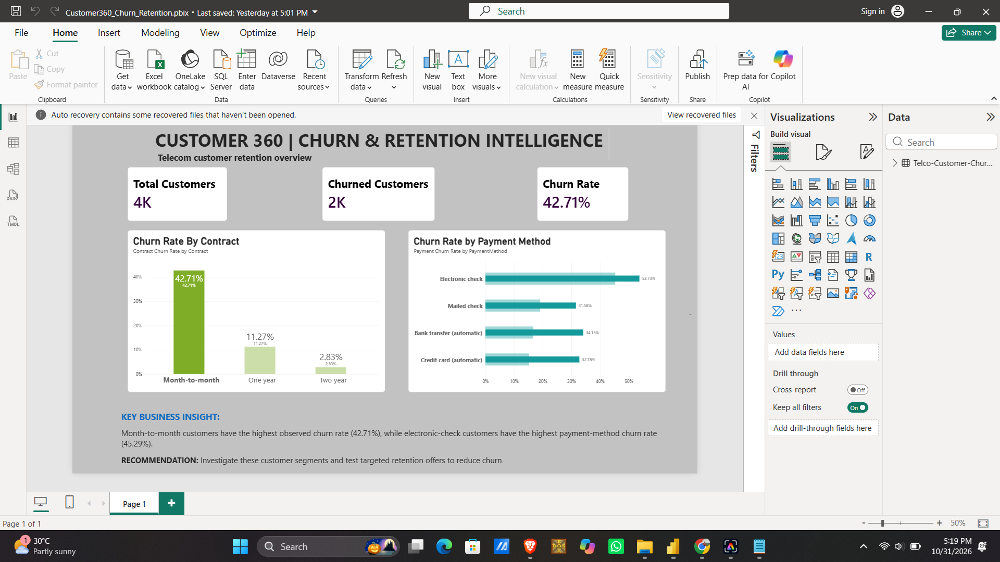

# Customer 360: Churn & Retention Intelligence

## Project Overview

Customer 360 is a data analytics project designed to understand customer churn patterns and identify customer segments that may benefit from targeted retention strategies.

The project uses the IBM Telco Customer Churn dataset and combines Python, SQL, and Power BI to clean customer data, analyze churn patterns, and present business insights through an interactive dashboard.

## Business Objectives

- Measure the overall customer churn rate.
- Compare churn across contract types.
- Identify payment methods associated with higher churn.
- Recommend data-driven customer retention strategies.

## Tools & Technologies

- **Python:** Data cleaning and exploratory data analysis using pandas.
- **SQL (SQLite):** Customer analysis, aggregation, and validation of results.
- **Power BI Desktop:** Dashboard development and visualization using DAX measures.
- **Git & GitHub:** Version control and project documentation.

## Dataset

The project uses the IBM Telco Customer Churn dataset, which contains 7,043 customer records and 21 columns covering customer demographics, services, contract details, charges, and churn status.

## Data Cleaning

- Converted `TotalCharges` into a numeric field.
- Identified 11 missing `TotalCharges` values.
- Retained all 7,043 customer records rather than deleting customers with missing charges.
- Checked for duplicate customer IDs and duplicate rows.
- Exported a cleaned CSV for SQL analysis and Power BI reporting.

## Key Findings

### Overall Churn

- Total customers: 7,043
- Customers who churned: 1,869
- Overall observed churn rate: 26.54%

### Churn by Contract Type

  Contract type          Customers     Churned     Churn rate 

  Month-to-month          3,875         1,655        42.71% 
  One year                1,473          166         11.27% 
  Two year                1,695           48          2.83% 

Month-to-month customers have the highest observed churn rate among the three contract types.

### Churn by Payment Method

   Payment method        Customers      Churned       Churn rate 

  Electronic check         2,365         1,071          45.29% 
  Mailed check             1,612           308          19.11% 
  Bank transfer (automatic 1,544           258          16.71% 
  Credit card (automatic)  1,522           232          15.24% 

Electronic-check customers have the highest observed churn rate among the payment methods analyzed.

## Business Recommendations

1. Investigate why month-to-month customers are more likely to churn.
2. Evaluate appropriate longer-term contract incentives.
3. Investigate the customer experience of electronic-check users.
4. Test targeted retention campaigns and measure their impact on churn.

These findings show associations in the dataset and do not establish that contract type or payment method causes churn.

## Power BI Dashboard


The dashboard includes:
- Total Customers
- Churned Customers
- Overall Churn Rate
- Churn Rate by Contract
- Churn Rate by Payment Method
- Key business insights and recommendations

## Project Structure

```text
coustomer360-analytics/
├── data/
│   ├── Telco-Customer-Churn.csv
│   └── Telco-Customer-Churn-Cleaned.csv
├── notebooks/
│   ├── day1_inspect.py
│   ├── day2_clean.py
│   ├── day3_churn_analysis.py
│   └── day5_customer_analysis.sql
├── reports/
│   ├── project_brief.txt
│   ├── day2_data_quality.txt
│   ├── day3_business_insights.txt
│   ├── day4_business_insights.txt
│   ├── churn_by_contract.csv
│   └── churn_by_payment.csv
├── customer360.db
├── Customer360_Churn_Retention.pbix
└── README.md
```

## Skills Demonstrated

- Data cleaning and validation
- Exploratory data analysis
- SQL aggregation and analytical queries
- DAX measures and KPI creation
- Business intelligence dashboard design
- Translating analytical findings into business recommendations

## Conclusion

This project demonstrates an end-to-end analytics workflow, from raw customer data to SQL analysis and a Power BI dashboard. It identifies customer segments with elevated observed churn rates and suggests areas for further investigation and retention testing.